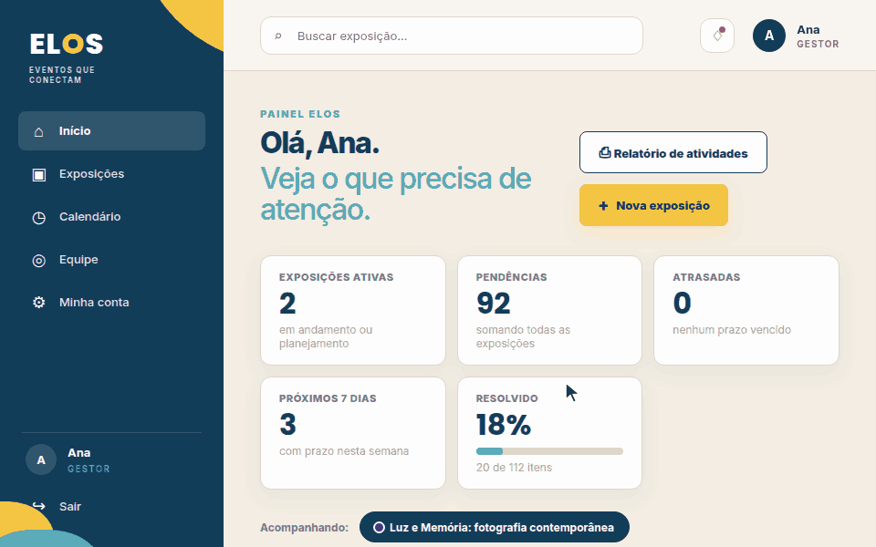
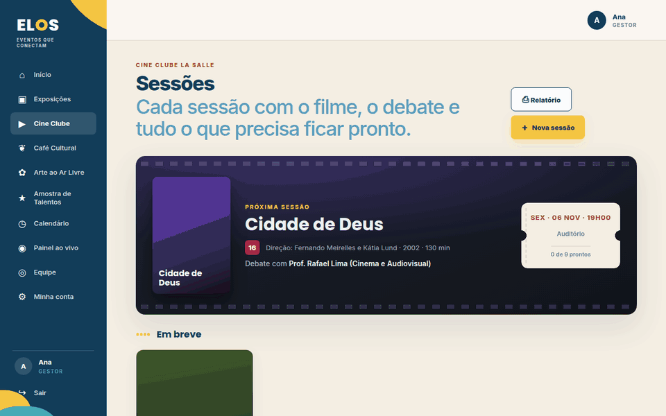
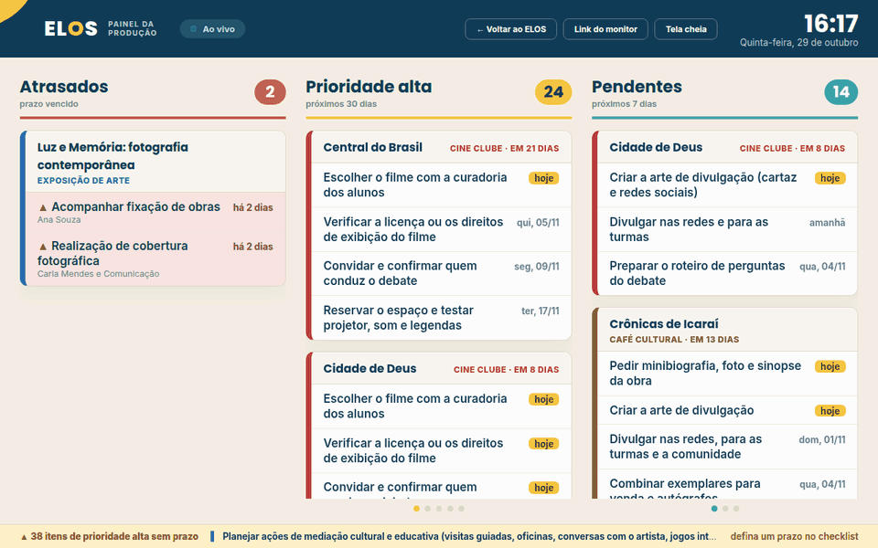
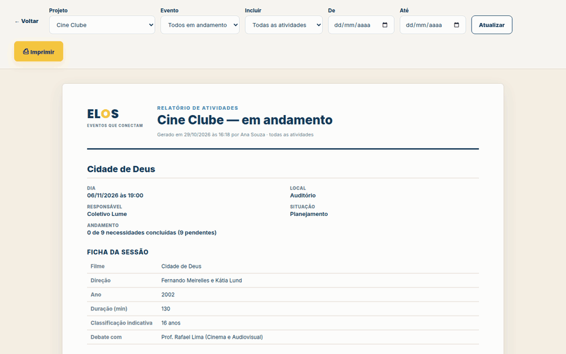

# ELOS: planejamento de eventos da galeria

**Eventos que conectam pessoas, ideias e oportunidades.**

O ELOS é um sistema web que organiza as exposições e os outros eventos da
Galeria de Arte La Salle (Unilasalle-RJ): Cine Clube, Café Cultural, Arte
ao Ar Livre e Amostra de Talentos. Antes, as informações de cada evento
ficavam espalhadas em planilhas, documentos e conversas. Agora ficam todas
num lugar só, e o próprio sistema avisa o que está atrasado ou perto do
prazo, inclusive num painel ao vivo para deixar aberto num monitor.

🔗 **Veja no ar:** [projeto-elos.alwaysdata.net](https://projeto-elos.alwaysdata.net)
· 💼 **Contato:** [LinkedIn: Manoela Silva](https://www.linkedin.com/in/manoela-silva-592641221/)

> Projeto desenvolvido sozinha por mim: telas, banco de dados, API,
> segurança e hospedagem.


---

## O ELOS em ação

> Os GIFs usam dados inventados, só para demonstração.

### Início com cara de galeria

O Início abre com a parede **"Em cartaz"**: as exposições penduradas como
quadros, com etiqueta de museu. Embaixo, os números de todas as
exposições em andamento, a exposição em destaque com o **andamento de
cada fase**, os alertas e os próximos eventos dos outros projetos.



### Um espaço para cada projeto

Cine Clube, Café Cultural, Arte ao Ar Livre e Amostra de Talentos têm a
mesma administração das exposições (ficha, checklist por fases, agenda,
anexos e histórico), cada um com a sua cara: o cinema tem cartaz e
bilhete, o café tem capa de livro, a arte ao ar livre tem varal e a
amostra tem palco. Cada evento novo já nasce com um checklist padrão,
com prazos contados a partir do dia do evento.



### Painel ao vivo para um monitor

Uma tela para deixar aberta o dia todo na produção: **atrasados**,
**prioridade alta** e **pendentes**, agrupados por evento e com a cor de
cada tipo. Atualiza sozinha a cada 30 segundos, avisa quando alguém
conclui ou cria um item e troca de página quando a coluna não cabe. Um
link secreto abre o painel no monitor sem entrar com a conta de ninguém.



### Criar uma exposição

A pessoa preenche o nome, o local, as datas e o que vai precisar. Se o
local já estiver ocupado nesse período, o ELOS **avisa antes de salvar**
e mostra qual exposição está lá.


### Acompanhar o checklist

Cada exposição tem uma lista do que precisa ser feito, organizada em
**fases** (Curadoria, Montagem, Divulgação…), cada uma com a sua cor e o
seu progresso. Filtros no topo mostram só uma fase ou só o que vence nos
próximos 7 dias. É só marcar o item como feito, e o progresso se
atualiza. Um item que passa da data sem ser concluído aparece como
**atrasado** sozinho.


### Cada exposição com a sua identidade

Cada exposição pode ter uma **imagem de capa** e uma cor. A imagem aparece
nos cards e some num degradê, sem atrapalhar a leitura. Ao enviar a
imagem, o ELOS sugere uma cor tirada dela.


### Calendário que se monta sozinho

Ninguém precisa preencher o calendário. Ele junta as datas de todos os
eventos e dos itens do checklist, cada tipo com a sua cor. Dá para
filtrar por projeto ou por evento.


### Relatório para imprimir

Um relatório de atividades de qualquer projeto ou de um evento só: a
ficha, as datas, o cronograma e o checklist por fase, pronto para
imprimir ou salvar em PDF.



### Equipe com aprovação

Quem quer entrar cria a própria conta, mas só consegue usar o sistema
depois que um gestor aprova. O gestor também pode promover alguém a
gestor.


### Funciona no celular


---

## O que eu usei e aprendi

| Área | O que tem no projeto |
|------|----------------------|
| **Back-end** | PHP 8 puro, sem framework, organizado em camadas (rotas → controllers → repositories). API REST que responde em JSON |
| **Banco de dados** | MySQL, com consultas protegidas por parâmetros (PDO) e arquivos de migração para cada mudança no banco |
| **Front-end** | PHP, HTML, CSS e JavaScript, sem bibliotecas. Layout responsivo (computador e celular) e identidade visual própria |
| **Regras de negócio** | situação do evento calculada pelas datas, aviso de local ocupado, itens atrasados, checklist padrão com prazos relativos ao dia do evento, histórico automático de quem fez o quê |
| **Tempo real** | painel ao vivo que se atualiza sozinho, com link secreto só de leitura para um monitor |
| **Login e permissões** | dois perfis (gestor e colaborador), aprovação de contas, "Entrar com Google" (OAuth), código para recuperar a senha |
| **Segurança** | senhas com hash, proteção contra CSRF e XSS, limite de tentativas de login, conferência do tipo real dos anexos |
| **Hospedagem** | no ar na alwaysdata, com HTTPS. Também deixei modelos de configuração para Nginx e Apache |
| **Git** | trabalho em branches e commits descritivos (`feat`, `fix`, `docs`…) |

---

## Rodando no seu computador

Precisa de **PHP 8.1+** (testado no 8.5) e **MySQL**. Em quatro passos:

```bash
# 1. banco de dados
mysql -u SEU_USUARIO -p < backend/database/elos.sql

# 2. configurações (preencha DB_USER, DB_PASSWORD...)
cp backend/.env.example backend/.env

# 3. liga a API (porta 8000) e as telas (porta 8081)
./iniciar-dev.sh

# 4. abra http://127.0.0.1:8081 e clique em "Criar conta"
```

Num banco vazio, a primeira conta já vira gestora. O passo a passo
completo, com Google e banco antigo, está em
[docs/instalacao.md](docs/instalacao.md).

---

## Documentação

| Guia | O que explica |
|------|---------------|
| [Como o ELOS funciona](docs/como-funciona.md) | as exposições e os projetos, o painel ao vivo, as regras de negócio e os perfis (gestor e colaborador) |
| [Como o código está organizado](docs/codigo.md) | as duas aplicações, as pastas, o caminho de um clique da tela até o banco e as combinações para mexer no código |
| [Rodando no seu computador](docs/instalacao.md) | instalação passo a passo, migrações e configurações |
| [API](docs/api.md) | todas as rotas do backend e quem pode usar cada uma |
| [Segurança](docs/seguranca.md) | senhas, CSRF, XSS, limite de tentativas, anexos e cabeçalhos |
| [Colocando no ar](docs/deploy.md) | VPS, hospedagem compartilhada e alwaysdata (onde o ELOS está hoje) |

---

## Princípio

O ELOS não precisa ser complicado para parecer sofisticado.

```text
CLAREZA → ORGANIZAÇÃO → FUNCIONALIDADE → EXPERIÊNCIA DE USO
```

---

Feito por **Manoela Silva** ·
[LinkedIn](https://www.linkedin.com/in/manoela-silva-592641221/)